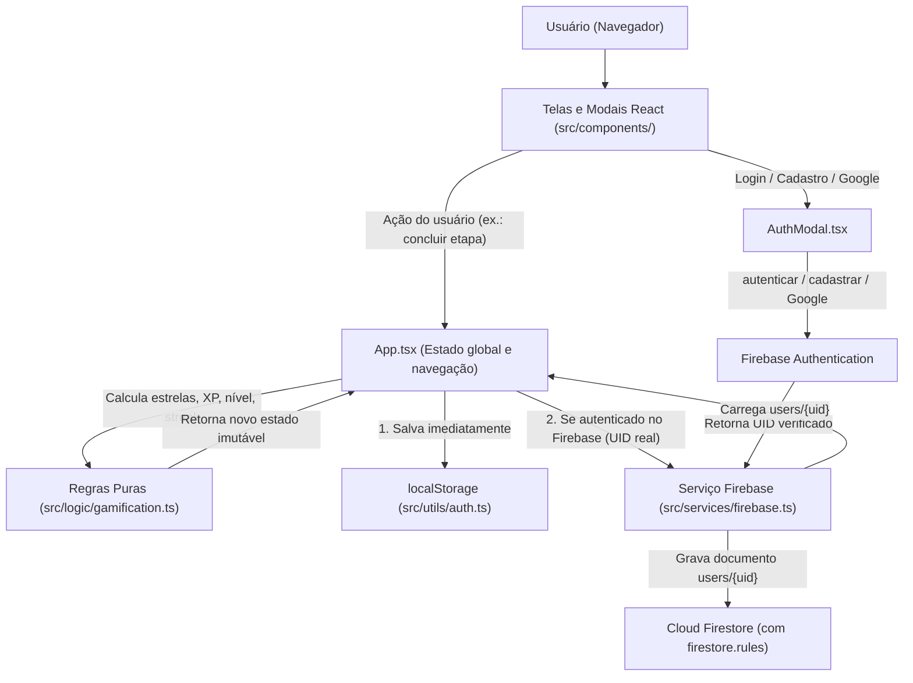

# Arquitetura do Lumi Libras

> Guia em linguagem direta para explicar como o **Lumi Libras** funciona por dentro durante a apresentação do TCC.

---

## 1. Visão geral: o que é o Lumi Libras?

O **Lumi Libras** é uma **SPA (Single Page Application)** — ou seja, uma aplicação web de página única construída com **React 19 + TypeScript + Vite + Tailwind CSS v4**.

- **Não existe um servidor backend próprio** (não há API em Node, Java ou Python rodando em servidor dedicado).
- Todo o código da interface e das regras de gamificação roda diretamente **no navegador do usuário** (arquivos estáticos publicados no **GitHub Pages**).
- Para **autenticação** (criar conta, entrar com e-mail/senha ou Google) e **banco de dados na nuvem**, o app usa o **Firebase** (modelo *BaaS — Backend as a Service*):
  - **Firebase Authentication:** gerencia login, cadastro e identidade (`uid`).
  - **Cloud Firestore:** guarda o documento de progresso de cada aluno na coleção `users/{uid}`.
  - **localStorage do navegador:** funciona como cache local imediato e mantém a sessão rápida de usuários autenticados.

---

## 2. Diagrama da arquitetura e fluxo de dados



---

## 3. Do clique até o banco de dados (passo a passo)

Imagine que o aluno acabou de responder a última pergunta da **Etapa 1** na Trilha:

1. **Interação na tela (`TrailScreen.tsx` + `TrailQuizView.tsx`):**
   - O usuário clica na mão correta.
   - O componente valida `opt.isCorrect`, dispara som (`src/utils/sound.ts`) e confete (`canvas-confetti`).
   - Ao terminar a última pergunta, chama `onCompleteStage(stage.id, stage.rewardStars, stage.rewardXp)`.
2. **Regra de negócio pura (`src/logic/gamification.ts`):**
   - O `App.tsx` recebe a chamada em `handleCompleteTrailStage` e delega para a função pura `concluirEtapa(...)`.
   - `concluirEtapa` adiciona o ID da etapa em `completedTrailNodes`, soma estrelas e XP, chama `atualizarNivel` (1 nível a cada 50 XP) e `atualizarSequenciaDias` (+1 na sequência apenas na primeira atividade do dia).
3. **Atualização da tela (`src/App.tsx`):**
   - `setProgress(...)` atualiza o estado global do React.
   - Automaticamente, `Header`, `HomeScreen`, `TrailScreen`, `ProfileModal` e `AchievementsScreen` passam a mostrar as novas estrelas, XP e a Etapa 2 desbloqueada.
4. **Persistência automática (`useEffect` em `src/App.tsx`):**
   - Sempre que `progress` muda, um `useEffect` executa duas etapas:
     - **Local:** chama `syncUserProgress` (`src/utils/auth.ts`) e salva no `localStorage`.
     - **Nuvem:** se o usuário estiver autenticado no Firebase (`currentUser.id.length > 20 && !currentUser.id.startsWith('user_')`), chama `salvarProgresso` (`src/services/firebase.ts`), que grava em `users/{uid}` com `{ merge: true }`.
5. **Segurança no servidor do Firebase (`firestore.rules`):**
   - Antes de aceitar a gravação, o Cloud Firestore verifica a regra `request.auth != null && request.auth.uid == userId`.
   - Ninguém consegue ler ou alterar o progresso de outro usuário.

---

## 4. Como o estado do usuário é carregado e salvo

### Estrutura do documento no Firestore (`users/{uid}`)
Cada usuário tem **um único documento** identificado pelo seu `uid` do Firebase Auth:

```json
{
  "id": "uid-do-firebase",
  "name": "Nome do Aluno",
  "email": "aluno@exemplo.com",
  "role": "geral",
  "avatar": "🌟",
  "createdAt": "2026-11-24T12:00:00.000Z",
  "lastActiveDate": "2026-11-24",
  "stats": {
    "stars": 15,
    "streakDays": 1,
    "xp": 75,
    "level": 2,
    "levelTitle": "Explorador de Sinais",
    "todayCompleted": true,
    "soundEnabled": true,
    "highContrast": false,
    "darkMode": false,
    "fontSize": "normal",
    "lastHighFiveDate": "2026-11-24",
    "weeklyTrainedDates": ["2026-11-24"]
  },
  "completedTrailNodes": ["etapa_1"],
  "seenAlphabetLetters": ["A", "B", "C"],
  "practicedWords": ["ola"],
  "unlockedAchievements": [],
  "unlockedStickers": ["lumi-wave"],
  "memoryGameWins": 0
}
```

### Dois modos de acesso
| Modo | Onde salva | Quando usar |
|---|---|---|
| **Conta Firebase (E-mail/Senha ou Google)** | `localStorage` (cache) + **Cloud Firestore** (`users/{uid}`) | Uso real: progresso sincronizado em qualquer dispositivo. |
| **Visitante (`guest_session`)** | Apenas em memória durante a sessão | Experimentação sem cadastro; ao concluir uma etapa, o app avisa para criar conta. |

---

## 5. Organização das pastas em `src/`

```text
src/
├── main.tsx                # Ponto de entrada: monta o React no HTML
├── App.tsx                 # Sumário do app: sessão, estado global, abas e modais
├── index.css               # Estilos globais, Tailwind v4, fonte Libras-2016 e acessibilidade
├── types/                  # Contratos TypeScript (TabType, UserStats, TrailAlphabetStage...)
├── logic/                  # Regras puras do sistema (gamification.ts)
├── services/               # Integração externa (firebase.ts: Auth + Firestore)
├── utils/                  # Utilitários (auth.ts local, storage.ts datas/nível, sound.ts Web Audio)
├── data/                   # Conteúdo pedagógico estático (etapas da trilha, alfabeto, vídeos UFV, conquistas, créditos)
└── components/
    ├── Header.tsx          # Barra superior fixa (estrelas, XP, tema, perfil)
    ├── Sidebar.tsx         # Menu lateral (desktop e mobile)
    ├── BottomCompanionBar.tsx # Barra inferior com o mascote Lumi
    ├── LumiMascot.tsx      # Componente visual do mascote
    ├── modals/             # Janelas modais (Auth + subformulários, Acessibilidade, Perfil, Toca aqui, Dicas, Créditos)
    └── screens/            # As 8 telas (Landing, Home + subcomponentes, Trilha + subcomponentes, Alfabeto, Sinais, Memória, Conquistas, Fontes)
```

---

## 6. Decisões arquiteturais importantes (boas para citar na banca)

1. **Separação entre interface e regras de negócio:** todas as fórmulas de gamificação ficam em `src/logic/gamification.ts` como funções puras (recebem o estado atual e devolvem o novo estado, sem depender de React ou banco). Isso facilita testar, explicar e manter.
2. **Sem bibliotecas pesadas de estado (sem Redux/Zustand):** o estado global cabe de forma limpa em `App.tsx` com `useState` agrupado (`progress` e `modals`), mantendo o código simples e legível.
3. **Efeitos sonoros sem arquivos MP3 (`Web Audio API`):** os sons de clique, acerto, erro e celebração são sintetizados matematicamente no navegador, deixando o app leve e sem risco de arquivo de áudio quebrado.
4. **Deploy automatizado (CI/CD):** o workflow `.github/workflows/deploy.yml` compila e publica o app automaticamente no GitHub Pages a cada push na branch `main`.
